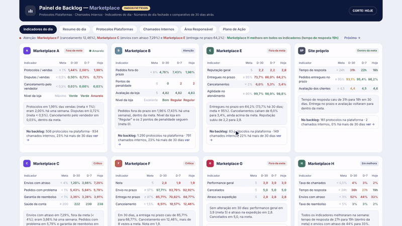
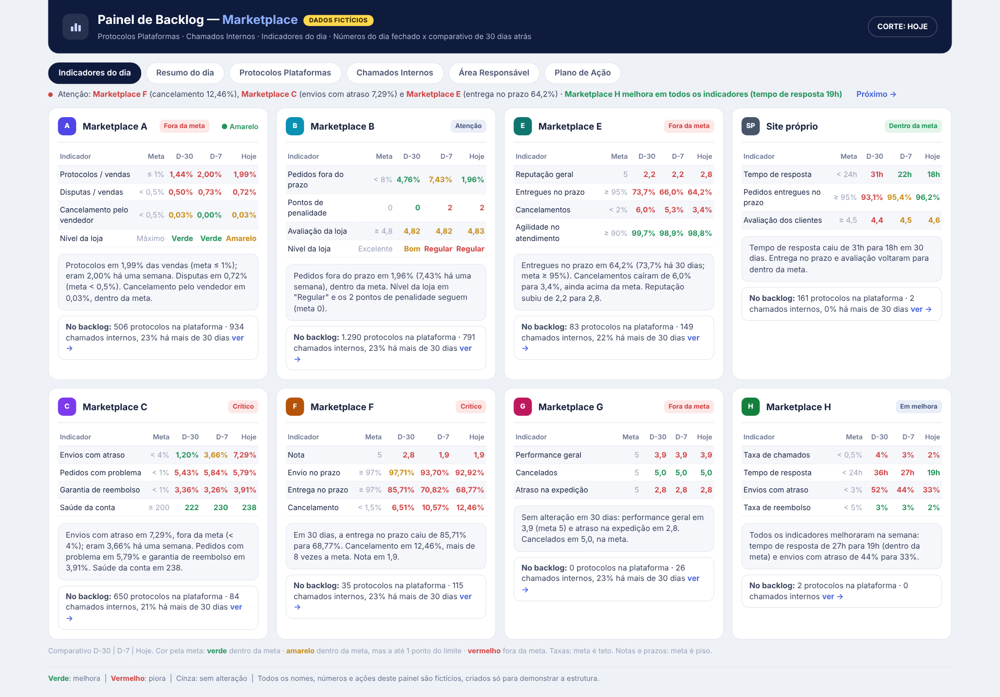
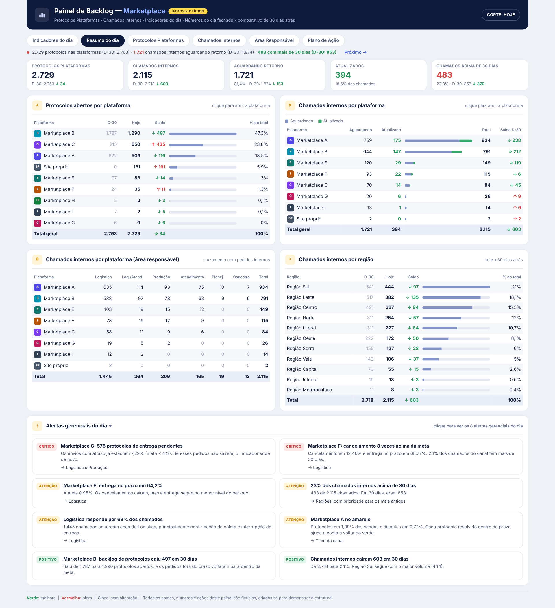
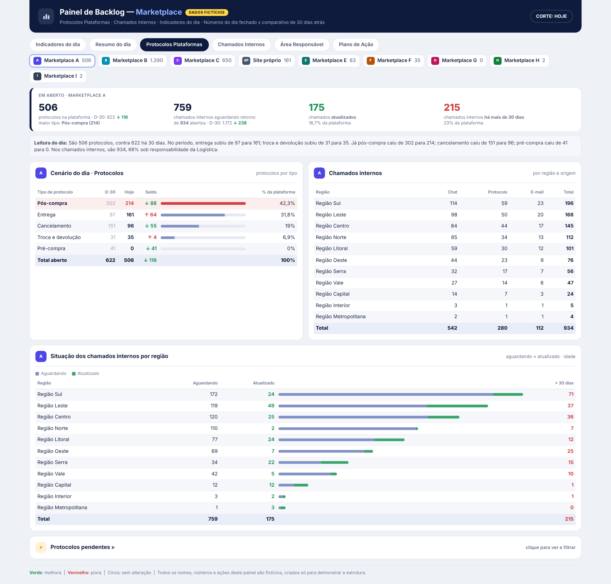
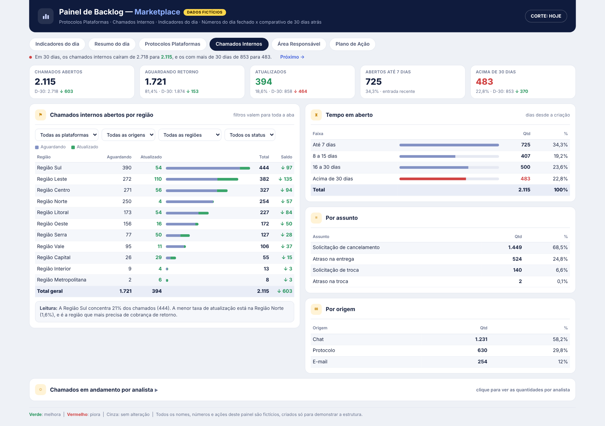
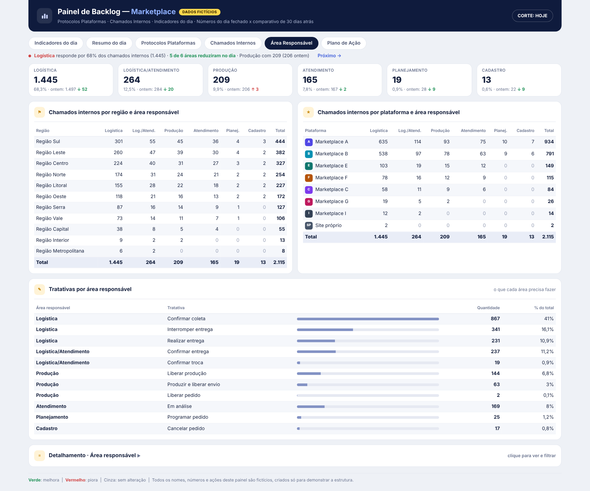
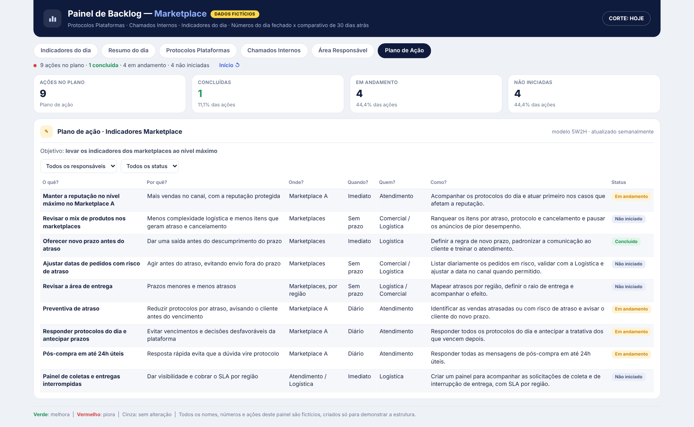

# Painel de Backlog — Marketplace

Painel interativo que consolida, em uma leitura diária, o backlog de protocolos das plataformas de marketplace, os chamados internos e os indicadores de desempenho de cada seller, para responder uma pergunta: **o que precisa de ação hoje, e de quem?**

> ⚠️ **Dados fictícios.** Este repositório é uma reprodução do projeto original com nomes, números e ações inventados, para preservar os dados reais. A estrutura, as regras e a lógica são as do painel original.



🔗  **Acesse o painel:** [vitoriacarolinedp-dev.github.io/painel-backlog-marketplace](https://vitoriacarolinedp-dev.github.io/painel-backlog-marketplace/)

## Problema de negócio

Em uma operação com vários canais de venda, a informação existe, mas está espalhada:

- cada plataforma tem o seu próprio painel de protocolos e indicadores;
- o sistema interno tem outra base, com os chamados abertos para as áreas;
- cada área enxerga só a sua parte do problema.

O resultado é muito tempo montando números e pouco tempo agindo sobre eles. Este projeto junta as três fontes em uma estrutura única, com comparativos, metas e responsáveis.

## Fluxo dos dados

```
Exportações das plataformas ─┐
Base de chamados internos ───┼─► Tratamento e padronização ─► Cruzamento por número do pedido
Indicadores dos sellers ─────┘                                          │
                                                                         ▼
              Painel interativo (6 visões) ◄─ Regras de negócio e alertas ◄─ Métricas e comparativos
```

## Visões do painel

| Aba | O que responde |
|---|---|
| **Indicadores do dia** | Como cada seller está frente às metas, com comparativo de 30 dias, 7 dias e hoje |
| **Resumo do dia** | Os números principais, o backlog por plataforma e região e os alertas gerenciais |
| **Protocolos Plataformas** | O backlog de cada canal por tipo de protocolo, com a leitura do dia |
| **Chamados Internos** | Volume, idade, assunto e origem dos chamados, com filtros |
| **Área Responsável** | Quanto cada área tem para tratar, e qual tratativa |
| **Plano de Ação** | As ações em andamento, no modelo 5W2H |

<details>
<summary><b>Ver telas</b></summary>

### Indicadores do dia


### Resumo do dia


### Protocolos Plataformas


### Chamados Internos


### Área Responsável


### Plano de Ação


</details>

## Técnicas utilizadas

- **ETL e integração de dados:** múltiplas fontes com estruturas diferentes, padronizadas em um modelo único
- **Cruzamento por chave:** ligação entre a base das plataformas e a base interna pelo número do pedido
- **Agregações e tabelas cruzadas:** por plataforma, região, tipo de protocolo, origem e área responsável
- **Série histórica diária:** comparativos de 30 dias, 7 dias e dia fechado, com saldo e direção da variação
- **Variáveis calculadas:** idade dos chamados e faixas de tempo em aberto
- **Regras de negócio:** classificação pela meta (teto e piso), tolerância e alertas com responsável
- **Validação de dados:** conferência de totais contra a soma das partes e tratamento de dados ausentes
- **Visualização:** painel interativo com filtros dinâmicos e hierarquia da informação pensada para quem decide

**Ferramentas:** JavaScript · HTML/CSS · Excel · IA como apoio ao desenvolvimento

## Decisões de projeto

- **Todo número tem comparativo.** Um valor isolado não diz se a operação melhorou ou piorou.
- **Todo alerta tem responsável.** Sem a área que precisa agir, o alerta vira só mais um número.
- **Meta-teto e meta-piso são tratadas de forma diferente.** Em uma taxa de cancelamento, menor é melhor; em uma nota de avaliação, maior é melhor.
- **A consistência vem antes do visual.** Todo total fecha com a soma das partes, em todas as visões.

Detalhes em [`docs/metricas.md`](docs/metricas.md) e [`docs/regras.md`](docs/regras.md).

## Como usar

1. Baixe o repositório ou acesse o link do GitHub Pages.
2. Abra o `index.html` em qualquer navegador. O arquivo não precisa de instalação nem de internet.
3. Navegue pelas abas, clique nas plataformas e use os filtros.

## Estrutura

```
painel-backlog-marketplace/
├── index.html          # painel (arquivo único, sem dependências)
├── README.md
├── docs/
│   ├── metricas.md     # dicionário de métricas
│   └── regras.md       # regras de negócio, alertas e validações
└── assets/
    ├── demo.gif
    ├── demo.mp4
    └── screenshots/
```

## Autora

**Vitoria de Paula** · Análise de dados aplicada a atendimento e marketplace
[LinkedIn](https://www.linkedin.com/in/vitoria-de-paula-master/)
